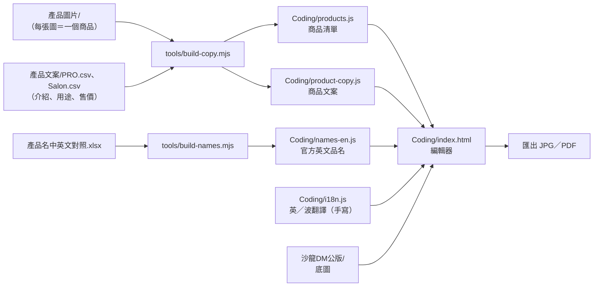
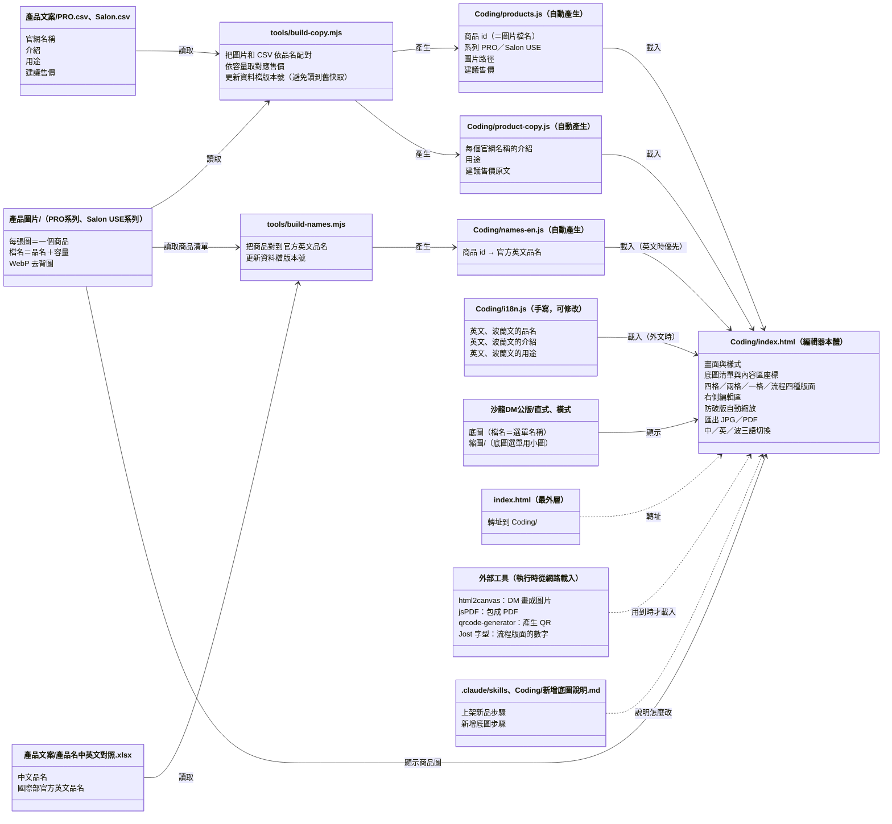
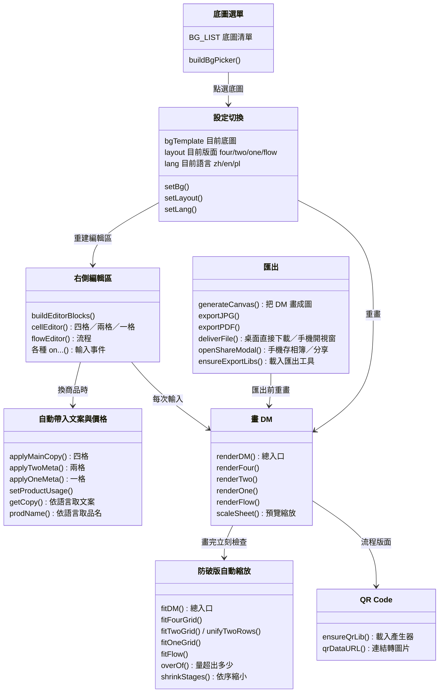

# 專案地圖

O'right PRO 沙龍 DM 編輯器：在網頁上選底圖、版面、商品，就能做出 A4 促銷單，匯出成 JPG 或 PDF。
網址：https://brandmarketing-coder.github.io/DM/ （同事多用手機開）

> 術語第一次出現時附白話解釋；完整解釋見 [詞彙表](詞彙表.md)。

---

## 一、資料夾與檔案

| 位置 | 是什麼 | 什麼時候會動到它 |
|---|---|---|
| `index.html`（最外層） | 只負責「轉址」：打開網站根目錄時自動跳到 `Coding/` | 幾乎不用動 |
| `Coding/index.html` | **編輯器本體**。畫面、樣式、所有功能都在這一個檔案裡 | 改版面、改功能、加底圖 |
| `Coding/products.js` | 商品清單（每張商品圖＝一筆）。**自動產生，勿手改** | 執行 `tools/build-copy.mjs` 時重建 |
| `Coding/product-copy.js` | 每個商品的文案：介紹、用途、建議售價。**自動產生，勿手改** | 同上 |
| `Coding/names-en.js` | 國際部提供的官方英文品名。**自動產生，勿手改** | 執行 `tools/build-names.mjs` 時重建 |
| `Coding/i18n.js` | 英文、波蘭文的品名／介紹／用途翻譯（機器翻譯，可手動修正） | 要修外文文案時 |
| `Coding/logo_new.png` | 編輯器左上角的 logo | 換 logo 時 |
| `Coding/Roadmap.md` | 版本紀錄（v0.1～最新），偏技術寫法 | 每次改版加一條 |
| `Coding/新增底圖說明.md` | 新增底圖的操作步驟 | 要加新底圖時照著做 |
| `tools/build-copy.mjs` | 小工具：讀「產品圖片」資料夾＋「產品文案」CSV，產生 `products.js`、`product-copy.js` | 新增／更換商品圖、改文案後執行 |
| `tools/build-names.mjs` | 小工具：讀「產品名中英文對照.xlsx」，產生 `names-en.js` | 國際部更新英文品名後執行 |
| `產品文案/PRO.csv`、`Salon.csv` | 文案來源表（官網名稱、介紹、用途、建議售價）。存檔請用 UTF-8 | 改文案、改價格、上新品 |
| `產品文案/產品名中英文對照.xlsx` | 國際部的官方中英文品名對照 | 國際部更新時換檔 |
| `產品圖片/PRO系列/`、`Salon USE系列/` | 商品去背圖（WebP 格式）。**檔名＝品名＋容量**，例如 `咖啡因養髮液100mL.webp` | 上新品、換圖 |
| `沙龍DM公版/直式/`、`橫式/` | 底圖。**檔名＝編輯器選單上的名稱**；各自的 `縮圖/` 子資料夾放底圖選單用的小圖（與底圖同名） | 加新底圖、換底圖 |
| `.claude/skills/` | 給 Claude 用的操作手冊：`dm-add-product`（上架新品）、`dm-add-background`（新增底圖） | 流程改變時更新 |
| `docs/` | 本文件、詞彙表等說明文件 | 每次改動後更新 |

### 底圖對照

| 選單名稱 | 代號 | 圖檔（在 `沙龍DM公版/` 底下） | 選單縮圖 | 版面 |
|---|---|---|---|---|
| 直式 | `portrait` | `直式/直式-頁首.jpg`＋`直式/直式-頁尾.jpg` | 用頁首＋頁尾即時拼成 | 四格／兩格／一格 |
| 大促直式 | `p2` | `直式/大促直式.jpg` | `直式/縮圖/大促直式.jpg` | 四格／兩格／一格 |
| 流程 | `p3` | `直式/流程.jpg` | `直式/縮圖/流程.jpg` | **只有流程版面**（選了就自動套用） |
| 橫式 1 | `h1` | `橫式/橫式1.jpg` | `橫式/縮圖/橫式1.jpg` | 兩格／一格（白框小，沒有四格） |
| 橫式 2 | `h2` | `橫式/橫式2.jpg` | `橫式/縮圖/橫式2.jpg` | 四格／兩格（單品特寫）／一格 |
| 橫式 3 | `h3` | `橫式/橫式3.jpg` | `橫式/縮圖/橫式3.jpg` | 四格／兩格（單品特寫）／一格 |
| 大促橫式 | `h4` | `橫式/大促橫式.jpg` | `橫式/縮圖/大促橫式.jpg` | 四格／兩格（單品特寫）／一格 |

---

## 二、資料怎麼流進編輯器

商品清單不是寫死在程式裡，而是由「圖片資料夾」和「文案表」自動合成：

**上新品的最短流程**：圖片放進 `產品圖片/PRO系列/`（檔名＝品名＋容量）→ `PRO.csv` 最後面加一列 → 執行 `node tools/build-copy.mjs` → commit、推上 GitHub。

---

## 三、架構圖

> 兩張圖都用「方框＋箭頭」表示：
> - **圖 1 檔案分工與關係**：每個方框是一份檔案或資料夾，框內列出它負責的內容；箭頭表示「誰產生誰」「誰讀取誰」。
> - **圖 2 程式模組分工**：`Coding/index.html` 裡面，每個方框是一組負責同一件事的函式（有名字、可重複呼叫的程式），箭頭表示誰呼叫誰。

### 圖 1：檔案分工與關係

**怎麼讀**：實線箭頭（`-->`）＝「讀取／產生／載入」，是資料真正流過去的方向；虛線箭頭（`..>`）＝「輔助關係」（轉址、說明文件、外部工具）。
**改了誰會影響誰**：沿著箭頭往右看。例如改了 `PRO.csv`，要先執行 `build-copy.mjs` 重新產生 `product-copy.js`，編輯器才會看到新文案。

### 圖 2：程式模組分工（都在 `Coding/index.html` 裡）

**一次操作的流程**：使用者在編輯區改了東西 → 存進 `state`（目前編輯中所有內容的那包資料）→ `renderDM()` 重畫 DM → `fitDM()` 檢查有沒有超出，有就逐步縮字、縮圖 → 畫面更新。按匯出時，`generateCanvas()` 把同一張 DM 畫成高解析度圖片。

---

## 四、外部依賴（不在這個專案裡、執行時從網路載入）

| 東西 | 用途 | 什麼時候載入 |
|---|---|---|
| html2canvas 1.4.1 | 把 DM 畫成圖片 | 按匯出時 |
| jsPDF 2.5.1 | 把圖片包成 PDF | 按匯出時 |
| qrcode-generator 1.4.4 | 由連結產生 QR Code | 切到「流程」底圖時 |
| Google Fonts「Jost」 | 流程版面的細體數字（步驟編號、價格） | 開網頁時；載不到就用系統字型 |

都從 cdnjs／Google 載入。

---

## 五、已知限制與規格備忘

### 已知限制
- **離線時不能匯出**：預覽和編輯照常可用，但匯出工具、QR 產生器都要從網路載入。斷線時匯出會失敗，可以改用瀏覽器的列印功能（電腦按 Ctrl+P）。
- **重新整理＝全部重設**：編輯內容不會自動儲存，按 F5 或「重設」會回到預設的直式四格；上傳的 QR 圖片也會消失。
- **外文價格要自己填**：中文價格會依建議售價自動帶入；英文、波蘭文的價格各自分開存，預設空白，需要手動輸入。
- **淺灰底圖遇到白底商品圖**：「流程」「大促」底圖的內容區不是純白。商品圖如果不是去背圖（帶白底），會看到白色方塊。
- **極端長內容會把字縮得很小**：防破版會自動縮字。在「流程」版面放 5 步、每步兩個不同商品、又切成外文時，說明字最小會縮到約 9px；再更長（例如約 1,450 字的波蘭文說明）仍可能超出幾 px。
- **舊版 iPhone 的下載**：iOS 15 以前不支援系統分享，匯出視窗會改顯示「下載檔案」按鈕，存到「檔案」而不是相簿。

### 規格備忘
- **DM 尺寸**：直式 595×842 px、橫式 842×595 px（等於 A4 在 72dpi 下的大小）；預覽時縮放到螢幕大小。
- **匯出解析度**：以 2 倍尺寸輸出。直式 JPG 為 1190×1684 px、橫式為 1684×1190 px；PDF 為 A4（210×297mm）。
- **直式（頁首＋頁尾）的內容高度**：約 561 px（842 − 頁首約 210 − 頁尾約 71）。
