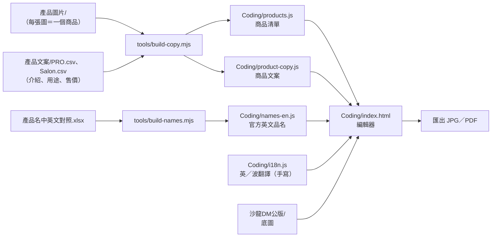
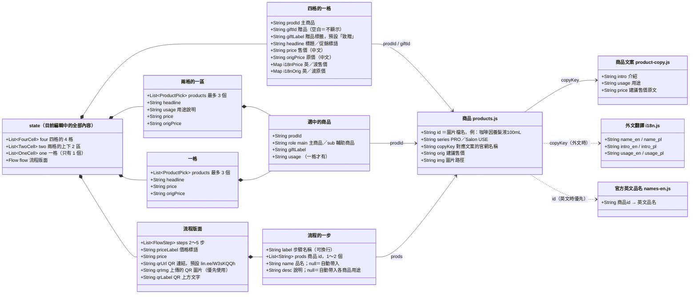
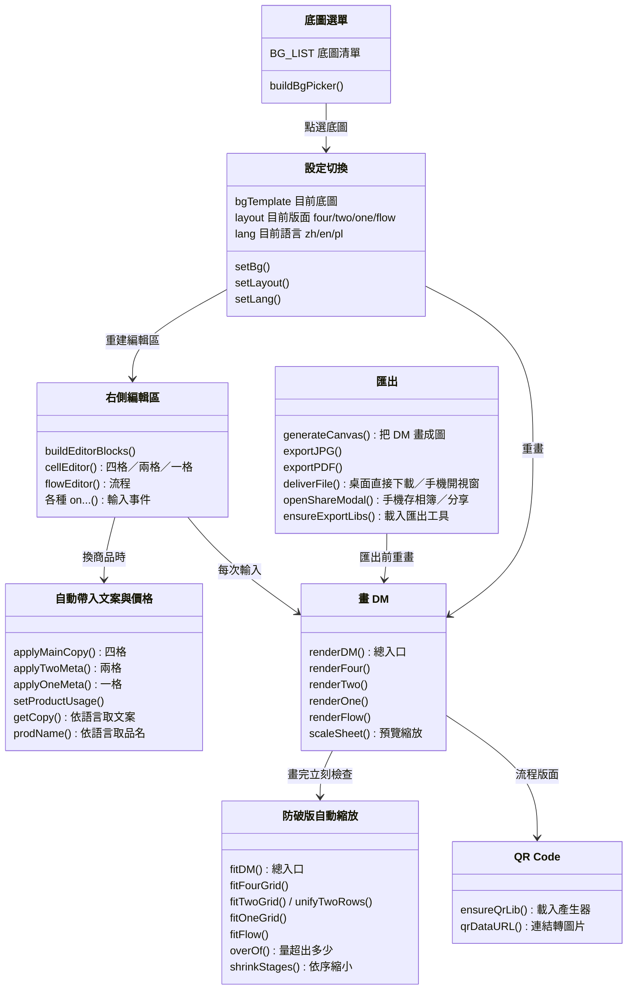

# 專案地圖

O'right PRO 沙龍 DM 編輯器：在網頁上選底圖、版面、商品，就能做出 A4 促銷單，匯出成 JPG 或 PDF。
網址：https://brandmarketing-coder.github.io/DM/ （同事多用手機開）

> 術語第一次出現時附白話解釋；完整解釋見 [詞彙表](詞彙表.md)。

---

## 一、資料夾與檔案

| 位置 | 是什麼 | 什麼時候會動到它 |
|---|---|---|
| `index.html`（最外層） | 只負責「轉址」：打開網站根目錄時自動跳到 `Coding/` | 幾乎不用動 |
| `Coding/index.html` | **編輯器本體**。畫面、樣式、所有功能都在這一個檔案裡 | 改版面、改功能、加底圖 |
| `Coding/products.js` | 商品清單（每張商品圖＝一筆）。**自動產生，勿手改** | 執行 `tools/build-copy.mjs` 時重建 |
| `Coding/product-copy.js` | 每個商品的文案：介紹、用途、建議售價。**自動產生，勿手改** | 同上 |
| `Coding/names-en.js` | 國際部提供的官方英文品名。**自動產生，勿手改** | 執行 `tools/build-names.mjs` 時重建 |
| `Coding/i18n.js` | 英文、波蘭文的品名／介紹／用途翻譯（機器翻譯，可手動修正） | 要修外文文案時 |
| `Coding/logo_new.png` | 編輯器左上角的 logo | 換 logo 時 |
| `Coding/Roadmap.md` | 版本紀錄（v0.1～最新），偏技術寫法 | 每次改版加一條 |
| `Coding/Plan.md` | 早期技術規格 | 參考用 |
| `Coding/Handoff.md` | 早期交接說明 | 參考用（部分內容較舊，以本文件為準） |
| `Coding/新增底圖說明.md` | 新增底圖的操作步驟 | 要加新底圖時照著做 |
| `tools/build-copy.mjs` | 小工具：讀「產品圖片」資料夾＋「產品文案」CSV，產生 `products.js`、`product-copy.js` | 新增／更換商品圖、改文案後執行 |
| `tools/build-names.mjs` | 小工具：讀「產品名中英文對照.xlsx」，產生 `names-en.js` | 國際部更新英文品名後執行 |
| `產品文案/PRO.csv`、`Salon.csv` | 文案來源表（官網名稱、介紹、用途、建議售價）。存檔請用 UTF-8 | 改文案、改價格、上新品 |
| `產品文案/產品名中英文對照.xlsx` | 國際部的官方中英文品名對照 | 國際部更新時換檔 |
| `產品圖片/PRO系列/`、`Salon USE系列/` | 商品去背圖（WebP 格式）。**檔名＝品名＋容量**，例如 `咖啡因養髮液100mL.webp` | 上新品、換圖 |
| `沙龍DM公版/` | 底圖。`th-*.jpg` 是底圖選單用的小縮圖 | 加新底圖 |
| `沙龍DM公版/公版DM-01～03.jpg` | 程式沒有使用（推測是原始設計稿） | — |
| `.claude/skills/` | 給 Claude 用的操作手冊：`dm-add-product`（上架新品）、`dm-add-background`（新增底圖） | 流程改變時更新 |

### 底圖對照

| 選單名稱 | 代號 | 圖檔 | 版面 |
|---|---|---|---|
| 直式 | `portrait` | `公版DM_1.jpg`（頁首）＋`公版DM_2.jpg`（頁尾） | 四格／兩格／一格 |
| 大促直式 | `p2` | `2026大促直式.jpg` | 四格／兩格／一格 |
| 流程 | `p3` | `直3.jpg` | **只有流程版面**（選了就自動套用） |
| 橫式 1 | `h1` | `橫1.jpg` | 兩格／一格（白框小，沒有四格） |
| 橫式 2、3 | `h2`、`h3` | `橫2.jpg`、`橫3.jpg` | 四格／兩格（單品特寫）／一格 |
| 大促橫式 | `h4` | `2026大促橫式.jpg` | 四格／兩格（單品特寫）／一格 |

---

## 二、資料怎麼流進編輯器

商品清單不是寫死在程式裡，而是由「圖片資料夾」和「文案表」自動合成：

**上新品的最短流程**：圖片放進 `產品圖片/PRO系列/`（檔名＝品名＋容量）→ `PRO.csv` 最後面加一列 → 執行 `node tools/build-copy.mjs` → commit、推上 GitHub。

---

## 三、類別圖（Class Diagram）

> **先說明**：這個程式沒有使用 JavaScript 的 `class` 語法，而是「一包資料＋一群函式」的寫法。
> 下面兩張圖借用類別圖的畫法來表示結構：
> - **圖 1**：每個方框是一種「資料的形狀」——裡面有哪些欄位、彼此怎麼包含。
> - **圖 2**：每個方框是一組「負責同一件事的函式」，箭頭表示誰呼叫誰。

### 圖 1：資料結構

**怎麼讀**：實心菱形（`*--`）＝「包含」，例如 state 包含 4 個四格格子；實線箭頭（`-->`）＝「用 id 指向」；虛線箭頭（`..>`）＝「切換外文時才查」。

### 圖 2：程式模組（都在 `Coding/index.html` 裡）

**一次操作的流程**：使用者在編輯區改了東西 → 存進 `state` → `renderDM()` 重畫 DM → `fitDM()` 檢查有沒有超出，有就逐步縮字、縮圖 → 畫面更新。按匯出時，`generateCanvas()` 把同一張 DM 畫成高解析度圖片。

---

## 四、外部依賴（不在這個專案裡、執行時從網路載入）

| 東西 | 用途 | 什麼時候載入 |
|---|---|---|
| html2canvas 1.4.1 | 把 DM 畫成圖片 | 按匯出時 |
| jsPDF 2.5.1 | 把圖片包成 PDF | 按匯出時 |
| qrcode-generator 1.4.4 | 由連結產生 QR Code | 切到「流程」底圖時 |
| Google Fonts「Jost」 | 流程版面的細體數字（步驟編號、價格） | 開網頁時；載不到就用系統字型 |

都從 cdnjs／Google 載入。網路斷線時：預覽可用，匯出和 QR 產生會失敗或延後。
