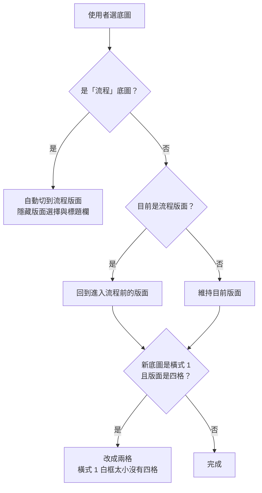
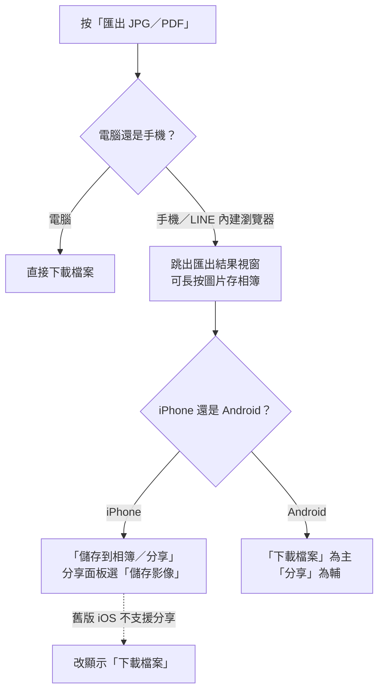

# 決策紀錄

記錄做過的決定：當時有哪些選項、選了哪個、為什麼。新的寫在最上面。
**「理由待補」**＝從版本紀錄看得出做了這個決定，但當時的理由沒有留下紀錄，請知道的人補上。

---

## 2026-11 文件規範與上新品流程

### D-31｜資料檔不留開頭說明、index.html 不加無用註解（11/13）
- **決定**：刪除 `products.js`、`product-copy.js`、`names-en.js` 開頭的說明文字；`index.html` 不新增無用註解，指向已刪除工具的註解一併刪除。
- **理由**：使用者表示開頭說明不需要；無用註解只會增加修改檔案的困擾。

### D-30｜變更紀錄、決策紀錄不計入「每步最多 3 個檔案」（11/13）
- **選項**：A 不計入；B 計入。
- **決定**：A。
- **理由**：使用者選擇。

### D-29｜上新品改為直接修改資料檔，刪除產品文案資料夾與產生工具（11/13）
- **選項**：A 只從 GitHub 移除 `產品文案`、電腦保留；B 電腦和 GitHub 都刪除；C 搬到專案外。
- **決定**：B。上新品改由 Claude 依使用者提供的品名與內容，直接修改 `products.js`、`product-copy.js`、`i18n.js`、`names-en.js`。取代 D-03 中「文案用 CSV」的部分。
- **理由**：`產品文案` 裡都是舊資料；使用者現在每次上新品，都直接提供新的品名與內容。
- **附帶決定**：
  - 兩個產生資料檔的工具（`build-copy.mjs`、`build-names.mjs`）：選項 A 刪除、B 改寫保留，選 A，刪除。
  - 上新品的 skill：選項 A 改寫 `dm-add-product`、B 新建另一個，選 A，名稱不變、內容換成新流程。
- **代價**：資料檔改為手動維護，修改後必須實際載入檢查，避免格式錯誤讓整份資料讀不到。

### D-28｜四份 docs 文件各有一個按需載入的 skill（11/13）
- **決定**：為變更紀錄、決策紀錄、專案地圖、詞彙表各建一個 skill，只在該文件需要修改的時機才載入。skill 內只寫規則與流程，不寫現有文件內容的摘要；流程用條列，不用 Mermaid。
- **理由**：讓之後的 Claude 修改這四份文件時，內容符合規範。skill 不用 Mermaid 是使用者更正（原提案為 skill 流程用 Mermaid 畫）。

## 2026-11 流程版面與文件整理

### D-27｜文件裡的流程一律用 Mermaid 畫（11/13）
- **決定**：文件裡凡是描述流程、步驟順序，都畫成 Mermaid 圖，不用「A → B → C」的文字句子。
- **理由**：使用者親自刪掉專案地圖裡用文字箭頭描述流程的段落，並指定流程圖用 Mermaid。

### D-26｜專案地圖採精簡版（11/13）
- **選項**：A 維持使用者精簡後的版本；B 把刪掉的流程改畫成 Mermaid 補回去。
- **決定**：A。
- **理由**：尊重使用者刪掉文字段落的選擇，文件保持精簡。

### D-25｜底圖依選單名稱命名、分直式／橫式資料夾（11/13）
- **選項**：A 只刪沒用的圖、位置不動；B 刪圖並把縮圖搬進子資料夾。
- **決定**：B，並再加碼：檔名改成和編輯器選單一樣，分 `直式/`、`橫式/`，縮圖放各自的 `縮圖/`。
- **理由**：舊檔名（`公版DM_1.jpg`、`直3.jpg`、`th-h1.jpg`）和選單名稱對不起來，換圖前得先查程式。
- **附帶決定**：
  - 搬圖要一次搬完 15 張並改程式路徑，超過「每步最多 3 個檔案」。這次**當作例外，一步完成**。理由：圖和路徑必須同時改，拆開反而會讓網站中途壞掉。
  - 沒被載入的直式縮圖 `th-portrait.jpg` **刪除**。直式的縮圖本來就是用頁首、頁尾即時拼出來的。

### D-24｜刪除過時與沒用的檔案（11/13）
- **決定**：刪除 `公版DM-01～03.jpg`（程式沒用到），以及 `Coding/Plan.md`、`Coding/Handoff.md`（內容已過時）。
- **理由**：留著會讓人誤以為還有作用。刪掉的檔案都還留在 git 紀錄裡，需要時可以救回。

### D-23｜docs 文件的建立方式（11/13）
- **選項**：A 先修 bug、下一步再建 docs；B 同一步一起做（超過 3 個檔案）；C 不建 docs，沿用 Roadmap。
- **決定**：A。決策紀錄裡推不出理由的，標「理由待補」。
- **理由**：一次只做一件事，比較好驗證；寧可留白，也不要寫出猜測的理由。

### D-22｜流程步驟的說明＝步驟內所有商品的用途，用「 / 」隔開（11/13）
- **決定**：一步有兩個商品時，說明列出兩個商品的用途；兩個用途一模一樣時只寫一次（例如同一商品的不同容量）。
- **理由**：原本只顯示第一個商品的用途，和列出兩個品名的標題對不起來。

### D-21｜流程品名用墨綠 #19322F、一般粗細（11/13）
- **理由**：原本是黑色粗體，和品牌墨綠色不一致。

### D-20｜「直式 3」改名為「流程」（11/10）
- **理由**：這張底圖只用在流程版面，名稱直接說明用途。

### D-19｜編輯區精簡：拿掉括號小字、按鈕改圖示（11/10）
- **決定**：
  - 編輯區的括號說明小字全部拿掉，例如「（最多 3 個）」「（元）」，只保留「匯出 PDF (A4 直式)」。
  - 新增商品、上移、下移、刪除改成圖示按鈕。
- **按鈕位置原則**：
  - 卡片標題列右側放「↑ ↓ ｜ 🗑」，刪除用分隔線隔開，避免誤按。
  - 清單標題列右側放「＋」。
  - 每個商品列右側放「🗑」。
- **理由**：使用者表示不需要那些小字；圖示讓編輯區更乾淨。

### D-18｜流程說明帶 CSV 的「用途」而不是「介紹」（11/10）
- **選項**：介紹（短標語，例如「奇激賦活 珍萃逆齡」）、用途（說明句，例如「深層淨化頭皮肌膚…」）。
- **決定**：用途。
- **理由**：使用者指定。範例 DM 上的說明是用途這種完整句子。

### D-17｜流程版面的定位：選底圖就自動套用（11/10）
- **選項**：A 當成第 4 種版面，和四格／兩格／一格並列；B 選到該底圖就自動套用。
- **決定**：B，且只有「流程」底圖能用。
- **理由**：使用者更正（最初提案是 A）。這張底圖就是為流程頁設計的：底部箭頭線的位置是留給價格的。

### D-16｜流程的 QR Code：預設官方 LINE，可改連結或上傳圖片（11/10）
- **決定**：
  - 預設用 `https://lin.ee/W3sKQQh` 自動產生 QR。店家可以改成自己的連結，或直接上傳 QR 圖片；上傳的圖片優先使用。
  - QR 上方的文字（預設「官方line」）可以改。
  - 連結留空又沒上傳圖片，就不顯示 QR。
- **理由**：使用者指定。範例上原本的 QR 是錯的，各店家要放自己的 LINE。

### D-15｜外部工具從 cdnjs 延遲載入，不放進專案（11/10）
- **決定**：QR 產生器跟匯出工具一樣，切到流程底圖時才從 cdnjs 載入。
- **理由**：嘗試把外部程式碼下載進專案時被權限擋下，所以沿用現有的延遲載入做法。
- **代價**：網路斷線時 QR 會先顯示灰色佔位，連上後自動補上。上傳圖片的方式不受影響。

## 2026-09 手機下載

### D-14｜手機匯出改用「匯出結果視窗」，iPhone 與 Android 分開處理（9/16）
- **決定**：
  - 電腦：直接下載。
  - iPhone：只留「儲存到相簿／分享」一顆按鈕，系統分享面板裡有「儲存影像」。
  - Android：「下載檔案」為主按鈕，「分享」為輔。
  - 拿掉「在新分頁開啟」按鈕，也拿掉 LINE 提示條的「或點右上角⋯」小字。
- **理由**：
  - 同事回報 iPhone 存不到相簿。原因是 iPhone 上所有瀏覽器都是同一個核心，舊的下載方式表現不一，而且 LINE 內建瀏覽器會擋下載。
  - Android 的分享面板只能分享、不能存檔，所以要以下載為主。
  - 後兩項是使用者看過實際畫面後指定拿掉的。

## 2026-08 介面與效能

### D-13｜按 F5 一律重設成直式四格，不再自動還原（8/27）
- **選項**：維持 v1.3 的自動存檔還原；或改成每次重新整理都重設。
- **決定**：重設。
- **理由**：使用者指定「重整時整個頁面重設，預設直式四格」。

### D-12｜資料缺漏暫緩補齊（8/27）
- **決定**：部分 Salon USE 商品沒有售價、少數商品沒有官方英文名、幾個新品沒有英／波翻譯，這些先暫緩不補。
- **理由**：使用者指示「資料待補先暫緩」。

### D-11｜「大促直式」版面比照「直式」（8/27）
- **理由**：使用者指定。內容區高度調到和直式接近，兩者的版面行為一致。

### D-10｜贈品標籤清空＝不顯示，但版面不動（8/27）
- **決定**：標籤預設「致贈」；把文字刪光就隱藏標籤，原本的空間保留。
- **理由**：使用者指定「刪掉就移除標籤，版面不動」。

### D-09｜手機用內建選單，電腦可打字搜尋商品（8/26）
- **理由**：手機上「打字搜尋選單」配上跳出的鍵盤很難用，使用者回報後改成手機內建的選單。

### D-08｜兩格改成可放多個商品、可設主／輔（8/21）
- **決定**：
  - 和一格相同，每個商品可設主商品或輔助商品，最多 3 個。
  - 品名放在各商品下方。
  - 用途帶入第一個主商品的用途。
- **理由**：使用者指定。

## 2026-07 多語與字級

### D-07｜PRO 香水 1～5 號的「用途」間距不動（7/27）
- **理由**：那是使用者刻意刪掉的格式，更新文案時不要套用表格裡的間距。

### D-06｜DM 上所有 11pt 以下的字一律放大到 12pt（7/21）
- **選項**：只放大指定的版面；或 DM 內所有文字。
- **決定**：DM 內所有文字。
- **理由**：使用者選擇。（為什麼選全部：理由待補）
- **備註**：防破版的自動縮放仍然可能把字縮小，以免內容超出。

### D-05｜英文品名以國際部對照表為準（7/20）
- **決定**：英文模式優先用國際部的官方英文品名，查不到才用機器翻譯。
- **理由**：理由待補。

### D-04｜外文價格改為手動輸入，每個語言各自存（7/13）
- **選項**：依匯率自動換算（7/8 的做法）；或每個語言自己填。
- **決定**：手動輸入，預設空白。
- **理由**：理由待補。

## 2026-05～06 基礎架構

### D-03｜商品清單由圖片資料夾產生、文案用 CSV（6/12）
- **決定**：放一張商品圖就多一個商品，文案從 CSV 自動帶入，不用改程式。（「文案用 CSV」已由 D-29 取代）
- **理由**：理由待補。

### D-02｜原價＝所選商品建議售價加總；定價預設＝原價，沒有原價就填 5000（6/8）
- **理由**：理由待補。

### D-01｜匯出改成直接產生 PDF／JPG，不用瀏覽器列印（5/18）
- **理由**：用瀏覽器列印時 iPhone 會跑版、內容超出。
