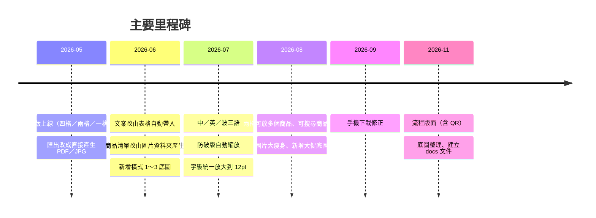

# 變更紀錄

每一步改動一條，用白話寫「做了什麼」。新的寫在最上面。
技術細節見 `Coding/Roadmap.md`；為什麼這樣決定見 [決策紀錄](決策紀錄.md)。

---

## 2026-11

- **11/13｜建立專案地圖與詞彙表的維護 skill**：新增 `docs-project-map`、`docs-glossary` 兩個 skill，規定這兩份文件何時要改、改哪些段落、怎麼寫；詞彙表補上「skill」「Node」。
- **11/13｜建立變更紀錄與決策紀錄的撰寫 skill**：新增 `docs-changelog`、`docs-decision-log` 兩個 skill（給 Claude 的操作手冊，需要時才載入），規定這兩份紀錄何時寫、寫在哪、怎麼寫；並記下今天關於文件規範與上新品流程的決定。
- **11/13｜建立變更紀錄與決策紀錄**：新增本文件與 `docs/決策紀錄.md`。
- **11/13｜專案地圖改為精簡版**：使用者親自刪掉文字說明段落、底圖對照表與已知限制，只保留檔案表和三張圖。
- **11/13｜移除過時文件**：刪除 `Coding/Plan.md`、`Coding/Handoff.md`；專案地圖第三節改名「架構圖」，圖 1 改成「檔案分工與關係」。
- **11/13｜新增底圖說明改用新規則**：`Coding/新增底圖說明.md` 和新增底圖的 skill 改成「檔名＝選單名稱、依直式／橫式分資料夾、縮圖放 `縮圖/`」。
- **11/13｜底圖改名並分資料夾**：底圖檔名改成和選單一樣（例如 `直3.jpg` → `直式/流程.jpg`），分成 `直式/`、`橫式/`，縮圖放各自的 `縮圖/`；刪除沒被載入的直式縮圖。編輯器路徑同步改好。
- **11/13｜刪除沒用的設計稿**：刪掉 `公版DM-01～03.jpg`（程式沒用到，約 2MB）。
- **11/13｜建立專案地圖與詞彙表**：新增 `docs/專案地圖.md`（含架構圖）、`docs/詞彙表.md`。
- **11/13｜流程版面三項修正（v2.8）**：步驟編號不再蓋住步驟名稱；一步有兩個商品時，說明列出兩個商品的用途、用「 / 」隔開；品名改成墨綠 #19322F、一般粗細。
- **11/10｜「直式 3」改名「流程」**：底圖選單上的名稱改掉（英文 Process、波蘭文 Proces）。
- **11/10｜流程說明改帶用途＋編輯區精簡（v2.7）**：流程的說明改用 CSV 的「用途」；編輯區拿掉括號裡的說明小字；新增商品、上移、下移、刪除改成圖示按鈕。
- **11/10｜新增流程版面（v2.6）**：選「直式 3」底圖就自動變成流程版面：步驟 2～5 步、每步 1～2 個商品、底部價格列、右下 QR Code（可改連結或上傳圖片）。
- **11/10｜新增底圖「直式 3」**：墨綠框頁首＋淺灰內容區的直式底圖。
- **11/10｜底圖選單分直式／橫式**：電腦是兩個下拉選單（滑鼠移上去會跳出預覽），手機是兩列左右滑動。
- **11/10｜新增操作手冊**：新增「新增底圖流程說明」，以及上架新品、新增底圖兩個 skill。

## 2026-10

- **10/30｜上架兩款升級版精華油**：豐盈彈韌精華油、染燙護色精華油的 70mL 升級版。

## 2026-09

- **9/16｜手機下載修正（v2.5）**：iPhone 在 Safari／Chrome／LINE 裡按匯出沒反應或存不到相簿的問題。手機改成跳出「匯出結果視窗」：iPhone 用「儲存到相簿／分享」，Android 以「下載檔案」為主；在 LINE 裡打開時，上方提示改用瀏覽器開啟。

## 2026-08

- **8/27｜贈品標籤修正（v2.4）**：標籤不再被壓扁；兩格上下的標籤大小一致；標籤文字清空就不顯示，版面不會跳動。
- **8/27｜全面瘦身＋F5 重設（v2.3）**：網頁第一次載入的圖片從約 25MB 降到 832KB；按 F5 一律重設成直式四格；修好「版面有時候跑掉」。
- **8/27｜圖片瘦身＋大促底圖（v2.2）**：大張商品圖轉成 WebP；新增「大促直式」「大促橫式」兩張底圖。
- **8/26｜上架 BioAir 系列新品**：BioAir 髮根支撐豐盈感噴霧、BioAir 造型噴霧；BioAir 強力造型噴霧換成木蓋版圖片並補上售價。
- **8/26｜手機版介面優化**：手機上方標題列變精簡；選商品改用手機內建選單。
- **8/26｜可搜尋的商品選單（v2.1）**：選商品時可以直接打字搜尋；修好「預設商品把選單卡住」。
- **8/21｜兩格可放多個商品（v2.0）**：每個商品可設主商品或輔助商品，最多 3 個；兩個商品時間距縮小。

## 2026-07

- **7/27｜更新後看不到新品的問題（v1.9）**：資料檔加上版本號，更新後瀏覽器會重新下載，不再顯示舊清單。同時上架 3 個 PRO 新品（沁涼舒活洗髮露、PRO 6 號香氛沐浴露、沁涼舒活身體冰感噴霧）。
- **7/21｜橫式四格標語消失修正（v1.8）**：長品名不再把標語擠到看不見。
- **7/21｜中文長品名排版（v1.7）**：兩格與特寫的品名改成在圖下整行排列，長品名不會疊成一高條。
- **7/21｜字級統一放大（v1.6）**：DM 上所有 11pt 以下的字都放大到 12pt。
- **7/21｜外文版面平衡（v1.5）**：英文、波蘭文的品名改成整行排列，英文單字不會被硬切斷。
- **7/21｜各版面字級微調（v1.4）**：依指示調整各版面的品名、用途、標題字級與商品圖大小。
- **7/21｜自動存檔＋預覽模式（v1.3）**：重新開啟會還原上次的編輯（之後在 v2.3 改成 F5 重設）；新增「預覽模式」和「重設」按鈕。
- **7/20｜字級放大＋直式兩格顯示用途（v1.2）**：直式兩格的商品下方加上用途說明。
- **7/20｜官方英文品名（v1.1）**：英文模式改用國際部提供的官方英文品名；開網頁變快。
- **7/20｜全版面防破版（v1.0）**：所有版面都會在內容太多時自動縮字、縮圖，不會超出版面。
- **7/13～7/20｜三語切換（v0.9）**：新增中／EN／PL 切換，DM 和編輯器介面一起換語言；外文價格改成手動輸入。

## 2026-06

- **6/15～6/17｜橫式底圖（v0.8）**：新增橫式 1／2／3 底圖；新增「匯出 JPG」；多輪橫式版面微調。
- **6/12｜商品清單由圖片產生（v0.7）**：放一張商品圖就多一個商品；文案改用 CSV。
- **6/8｜用途與價格規則（v0.6）**：一格版面每個商品顯示自己的用途；原價＝所有選中商品的建議售價加總。
- **6/8｜文案自動帶入（v0.5）**：選商品就自動帶入介紹、建議售價；一格新增「用途」欄位。
- **6/1～6/5｜一格可放多個商品**：一格版面最多 3 個商品，可設主商品或輔助商品。
- **6/3｜新增 Salon USE 系列**：商品選單加上【PRO】／【Salon USE】標籤。

## 2026-05

- **5/27｜字級放大＋匯出 JPG 按鈕**：預覽文字放大，新增匯出 JPG。
- **5/18｜匯出改成直接產生檔案**：原本用瀏覽器列印，iPhone 會跑版；改成直接產生 PDF。每格的贈品標籤可以自己改字。
- **5/13～5/15｜初版上線（v0.1～v0.4）**：四格／兩格／一格三種版面、商品下拉選單、價格輸入；放上 GitHub Pages。
